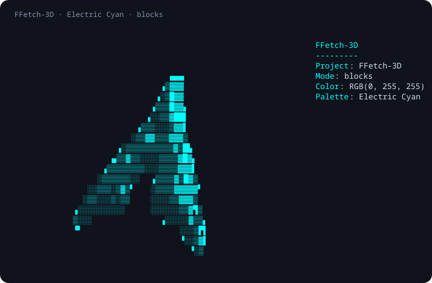

# FFetch-3D

**Give your terminal a pulse.**

FFetch-3D displays system information beside an animated, rotating 3D terminal
logo. Choose true-color RGB values, spin up a random neon palette, or keep a
fixed cyan preset. Logo surfaces and information labels share the same color
when using either launcher.

This is a fork of [areofyl/fetch](https://github.com/areofyl/fetch), based on its
2.3.0 renderer. The original project provides the point-cloud renderer, system
information collectors, logo loading, and animation. FFetch-3D builds on that
work with RGB customization, neon launchers, and maintenance improvements.



*Cyan blocks preview captured from this renderer; example information fields
and a sanitized title. The inherited [upstream animation](demo.gif) illustrates
rotation, rather than the fork's neon palette.*

## Features

- Animated ASCII/Unicode logos, with optional Fastfetch logo loading.
- 24-bit `rgb:R:G:B` colors for logo faces, extruded sides, and info labels.
- Twelve original neon colors, selected independently for each launch.
- A fixed cyan preset, plus named ANSI colors and numeric SGR parameters.
- ASCII ramps, 2×2 quadrant blocks, and 2×3 sextants.
- Configurable rotation, speed, scale, depth, lighting, fields, and borders.
- Responsive side-by-side and stacked layouts with a stable two-row logo offset.
- Separate executable and configuration names, so the fork can coexist with Fetch.

## Build and install

Build requirements: a C compiler, GNU Make, and the platform math library.
The launchers require Bash. Tests require Python 3.9+ and POSIX pseudo terminals.
A UTF-8 terminal with 24-bit color support is needed for the intended appearance.
Glyph coverage depends on your terminal and font, especially for sextants.

Build from the repository directory:

```sh
git clone https://github.com/Isaraft/fetch.git FFetch-3D
cd FFetch-3D
make
make test
./ffetch-3d --help
./scripts/neonfetch --frames 80
```

Fastfetch is needed to select named logos, including the Arch logo selected by
the launchers. Without it, the renderer falls back to its built-in Gentoo logo.
Custom `logo.txt` artwork can also be used without Fastfetch.

For a user-local install:

```sh
make install PREFIX="$HOME/.local"
```

Ensure `$HOME/.local/bin` is on your `PATH`. Installation creates these commands:

| Command | Behavior |
| --- | --- |
| `ffetch-3d` | Renderer with your saved settings |
| `ffetch-neon` | Arch, blocks, and a random synchronized neon color |
| `ffetch-arctic` | Arch, blocks, and synchronized cyan |

The build does not install anything automatically. `make install` installs no
shell hooks and does not write a user configuration. It also supports `DESTDIR`
for staging. Documentation and the example config go in
`PREFIX/share/doc/ffetch-3d/`.

The source retains inherited platform-specific collectors, but this fork has
been built and tested on Arch Linux x86_64 only. Other platforms and packaging
systems are not yet validated; see [packaging notes](packaging/README.md).

## Usage

```sh
ffetch-neon
ffetch-arctic --size 1.5 --height 45
ffetch-3d -l arch --shading-mode blocks --color rgb:255:0:255
ffetch-3d -l debian --rotate-y --speed 0.7 --frames 100
ffetch-3d --no-info --shading-mode ascii
ffetch-3d --infinite
```

Any key or Ctrl-C ends the animation. Mouse dragging, inherited from Fetch,
changes rotation in terminals supporting its mouse protocol.
The default animation limit is 2,000 frames, with a nominal 50 ms frame delay;
this is an implementation setting, not a performance guarantee.

The launchers forward all arguments, preserving spaces and argument boundaries.
Later arguments override their defaults:

```sh
ffetch-neon --logo nixos --size 1.5
ffetch-arctic --color rgb:255:20:147
ffetch-neon --config ./examples/config --frames 60
```

`FFETCH_3D_BIN=/path/to/ffetch-3d` can select a particular renderer for a launcher.
Otherwise launchers look beside themselves, in the repository parent directory,
and finally on `PATH`. Existing `neonfetch`, `arcticfetch`, and `fetch-neon`
installations are not replaced by these installation names.

## Configuration and RGB

The default config is `$XDG_CONFIG_HOME/ffetch-3d/config`; when that variable is
unset or relative, it falls back to `$HOME/.config/ffetch-3d/config`.
An explicit `--config PATH` reads that file instead. Missing explicit files are
errors. The renderer never writes configuration files.

To start with the example, copy it to that directory yourself. No config is
required: built-in defaults apply when the default file is absent.
Configuration from the original Fetch or local NeonFetch installation is not
automatically imported.

```ini
os
kernel
uptime
cpu
memory

shading_mode=blocks
light=top-left
spin=xy
size=1.0
depth=1.5
logo_outer=rgb:0:255:255
logo_inner=rgb:0:255:255
label_color=rgb:0:255:255
```

RGB components must be unsigned decimal values from 0 to 255, with one to three
digits each. Signs, extra components, trailing junk, and overflow are rejected.
Named colors are `red`, `green`, `yellow`, `blue`, `magenta`, `cyan`, and `white`.
Numeric SGR values from 0 through 107 are also accepted; ordinary foreground
colors are 30–37 and 90–97. Other SGR values can change terminal attributes.

Invalid config colors produce a diagnostic and retain the previous value.
Invalid command-line colors fail before animation starts.
Numeric settings must be finite and within their documented ranges; invalid
CLI values fail instead of being silently clamped. Speed accepts −1000 to 1000,
including zero for a stationary logo and negative values for reverse rotation.
CLI settings override configuration. Repeated CLI colors apply in order;
`--color` sets all three colors, while the following options affect one:

```sh
ffetch-3d -l arch --color rgb:0:255:255 --logo-inner white --label-color cyan
```

Explicit logo surface colors override embedded logo colors. Without a surface
override, embedded colors remain available. Labels are independently configurable.
`--no-color` disables logo coloring only, matching inherited Fetch behavior.

Custom artwork lives at `$XDG_CONFIG_HOME/ffetch-3d/logo.txt`, with the same HOME
fallback. `--logo NAME` takes precedence over that artwork. `--config` changes
the config file only, not the default artwork directory.

See the [configuration reference](docs/configuration.md),
[custom logo guide](docs/custom-logos.md), and [CLI help](#usage).

## Neon palette

Each launch selects one of these twelve original values. Launching concurrent
windows does not change any saved config or another process's color.

| Color | Hex | RGB |
| --- | --- | --- |
| Cyber Pink | `#FF00FF` | `255:0:255` |
| Electric Cyan | `#00FFFF` | `0:255:255` |
| Acid Green | `#39FF14` | `57:255:20` |
| Ultraviolet | `#BF00FF` | `191:0:255` |
| Hot Pink | `#FF1493` | `255:20:147` |
| Laser Blue | `#0080FF` | `0:128:255` |
| Neon Orange | `#FF5F00` | `255:95:0` |
| Electric Lime | `#CCFF00` | `204:255:0` |
| Crimson | `#FF1744` | `255:23:68` |
| Violet | `#8F00FF` | `143:0:255` |
| Turquoise | `#00FFC8` | `0:255:200` |
| Gold | `#FFD600` | `255:214:0` |

## Rendering modes

| Mode | Representation | Considerations |
| --- | --- | --- |
| `ascii` | Character brightness ramp | Default; custom ramps via `--shading-chars` |
| `blocks` | 2×2 quadrant coverage | The neon launchers' default |
| `sextants` | 2×3 block coverage | Requires suitable Unicode glyph support |

Use `--shading-mode MODE` or `shading_mode=MODE`. A custom shading ramp implies
ASCII mode. See [rendering details](docs/shading-modes.md).

## Implementation and development

The inherited renderer converts logo characters into a relief point cloud,
computes surface normals, rotates and projects points, and emits terminal frames
with depth buffering and lighting. Native collectors supply system information;
Fastfetch supplies named logo artwork when available.

FFetch-3D adds a shared validated color parser and real ANSI 24-bit escape
sequences. Per-process CLI overrides replace launcher writes to shared files.
The Fastfetch logo subprocess uses direct argument passing. Startup and resize
share projection calculations and retain the approved `+2.0f` vertical offset.

```sh
make test
make -B CFLAGS='-O2 -Wall -Wextra -Wformat=2'
```

Tests cover color boundaries and malformed input, subprocess arguments,
concurrent launchers, CLI precedence, real terminal frames, resize consistency,
and staged installation. See [development and validation](docs/development.md)
and [CHANGELOG.md](CHANGELOG.md).

Large scales, extreme depth, or small terminals can still clip rotating geometry.
The current layout preserves the established visual design; it does not compute
a rotation-wide bounding volume. Inherited compiler warnings also remain.

## Security contribution

During FFetch-3D development, we identified and fixed a command-injection
vulnerability in the inherited external-logo loading path. This finding is
part of the fork's contribution alongside its neon rendering: the fix makes
logo names literal subprocess arguments, backed by regression tests for
argument handling and a missing Fastfetch executable.

The work is preserved in a [dedicated security commit](https://github.com/Isaraft/fetch/commit/16cee7d1ff252d79c42fbff90776e0f72fb88b82).
The original renderer and logo-loading feature remain credited to areofyl/fetch.

## Credits and license

Based on [areofyl/fetch](https://github.com/areofyl/fetch), copyright © 2026 areofyl.
The original renderer was not written from scratch for FFetch-3D.
Upstream history, its ISC copyright and permission notice, documentation, and
original demo are retained. The fork's changes are distributed under the same
[ISC license](LICENSE).
